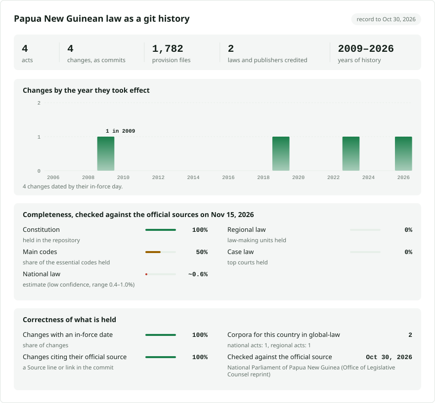

# Papua New Guinea: law history in git

<picture>
<source media="(prefers-color-scheme: dark)" srcset="data/effort-dark.svg">

</picture>

The law of Papua New Guinea as a git history: one file per section, one commit per version on the day it took effect, and the law that made each change as the commit's author. `git blame` names the law behind every paragraph; `git log` lists every change to a section; picking a date gives the text in force that day.

Part of [lexifina/global-law](https://github.com/lexifina/global-law), one git history for every country's law: this is Papua New Guinea's national law, which global-law reads at `papua-new-guinea/national/acts/`.

**What is in it now:** the Constitution, the Criminal Code Act 1974, the Companies Act 1997 and the Employment Act 1978 (one consolidated version each), and 164 further Acts and 81 items of subsidiary legislation and Rules of Court, each version dated by the day it took effect (203 of them from secondary copies, WIPO Lex and FAOLEX, where no official copy with a text layer is online). [`STRUCTURE.md`](STRUCTURE.md) gives the layout and the dating rules.

Each act is a folder (`acts/<year>/<number>-<name>/`, `subsidiary/<year>/<name>/`) with one file per section and schedule, and a `README.md` listing its provisions (`acts/1978/employment/s-061.md` is section 61 of the Employment Act 1978, Chapter 373); the Constitution also has its preamble and one `heading-NNN` file per part, division and subdivision, in reading order.

The text is in English, as the sources print it.

## Questions as git commands

| Question | Command |
| --- | --- |
| Every change to section 61 of the Employment Act | `git log -p --word-diff -- acts/1978/employment/s-061.md` |
| Which law wrote each line of section 61? | `git blame acts/1978/employment/s-061.md` |
| Every version of the Employment Act, with the day each took effect | `git log --format="%h %(trailers:key=In-force,valueonly,separator=) %an" -- acts/1978/employment ':!*/README.md'` |
| Section 61 as it stood on 1 January 2026 | `python tools/on.py 2026-01-01 acts/1978/employment 61` |

**Outside git**, we also host this record publicly, for free:

- **[Ask Claude about Papua New Guinean law](https://global-law.lexifina.com/v1/try_claude?country=papua-new-guinea)**: opens Claude with a first question ready.
- **[Ask ChatGPT](https://global-law.lexifina.com/v1/try_chatgpt?country=papua-new-guinea)**: the same question in ChatGPT.
- **[Search Papua New Guinean law on our site](https://lexifina.com/law?country=papua-new-guinea&q=recreation+leave)**: a search for "recreation leave", with each provision's text and its versions, no account needed.
- **[Developer REST API](https://global-law.lexifina.com/v1/search_law?query=recreation+leave&jurisdiction=papua-new-guinea)**: the same search as JSON, with no key. See the [documentation here](https://lexifina.com/api/global-law).

Both assistants read the record through the free Global law connector (MCP, `https://global-law.lexifina.com/mcp`); the first time, the chat gives you the link that adds it. Ask in English.

**Host it yourself easily.** All it takes is git and Python, and the tools run on your machine:

```sh
git clone --depth 1 https://github.com/lexifina/global-law && cd global-law
python3 tools/countries.py add papua-new-guinea/national/acts
python3 tools/law.py show 2026-01-01 papua-new-guinea/national/acts/acts/1978/employment/s-061.md
```

Opened in Claude Code, Cursor, VS Code or Codex, the clone also starts a local MCP server with the same tools ([MCP.md](https://github.com/lexifina/global-law/blob/main/MCP.md)).

## Dates

Each commit is dated at noon, Pacific/Port_Moresby, and carries its day in its `In-force:` trailer. The first four acts' sources give no day their text took effect, so each one's single version is dated by its PDF (below); every later version is dated by the rules in [`STRUCTURE.md`](STRUCTURE.md):

- the Constitution, 2009-10-09, the day the Parliament's PDF reprint was made (the Constitution came into force on 16 September 1975);
- the Criminal Code, 2023-11-06, and the Companies Act, 2026-06-09, the last-modified dates of the PDFs on the ICAC and IPA websites;
- the Employment Act, 2019-05-08, the last-modified date of the Department of Personnel Management's PDF (section 1 gives its commencement as 1 January 1981).

`tools/on.py` reads the trailer, so it gives no text for a day before these. Each version is credited to its publisher as "oldest version available": the Employment Act to the Department of Personnel Management, the other three to `National Parliament of Papua New Guinea (Office of Legislative Counsel reprint)`, though the Criminal Code and Companies Act texts come from the ICAC and IPA websites.

## How it is checked

- `tools/check_repo.py` reads every version back from git on the day it took effect and on the day before, and compares it with the corpus it was built from: 4 versions of 4 acts, 0 mismatches.
- Every commit's trailers parse; there are no merge commits, no commit dates that go backwards and none after the build.
- A second build from the same corpus gave the same hashes for all 4 commits and 4 tags (see [`REPRODUCE.md`](REPRODUCE.md)).
- History is append-only: later builds add commits on top (`tools/append.py`) and never rewrite published ones.
- [vulnerabilities/](vulnerabilities/): possible drafting mistakes in this law, found by global-law's detectors and checked by hand. Not run yet.

## What it does not show

- **Past versions and amending laws.** Each source publishes one consolidated text; the footnotes naming the amending laws are not reproduced.
- **Recent amendments.** The Companies Act file is described as consolidated to 2014, the Criminal Code and the Employment Act print no consolidation date, and the Constitution is a reprint whose PDF was made in 2009; later amendments may be missing.
- **Most of the law.** The Parliament's certified copies of recent Acts are mostly scans without a text layer, and no OCR is run, so they are not read; Acts whose commencement is left to a notice are held. No case law: the courts publish none on their own site, and PacLII is not used. The Constitution of the Autonomous Region of Bougainville is in [papua-new-guinea-bougainville-law](https://github.com/lexifina/papua-new-guinea-bougainville-law).
- **Page furniture and repealed sections.** Running headers, page numbers, the Acts' part and division headings, and Criminal Code sections printed as "[REPEALED.]" are left out.

## Sources

| Source | Kind | Past versions | Notes |
| --- | --- | --- | --- |
| [National Parliament of Papua New Guinea](https://parliament.gov.pg/constitution-of-png/) | Constitution, consolidated reprint of the Office of Legislative Counsel | no, one reprint | PDF dated 2009 |
| [Independent Commission Against Corruption](https://icac.gov.pg/wp-content/uploads/2023/11/Criminal-Code-Act-1974.pdf) | Criminal Code Act 1974 (Chapter 262), consolidated | no | Office of Legislative Counsel consolidation, undated |
| [Investment Promotion Authority](https://www.ipa.gov.pg/Documentation/PG/ActsAndRegulations/Companies_Act_1997_(consolidated_to_2014).pdf) | Companies Act 1997 (No. 10 of 1997), consolidated | no | Described as consolidated to 2014 |
| [Department of Personnel Management](https://www.dpm.gov.pg/wp-content/uploads/2019/01/Employment-Act-1978.pdf) | Employment Act 1978 (Chapter 373), Employment and Industrial Relations Library | no | No consolidation date |
| [PNG Judiciary, Rules of Court](https://www.pngjudiciary.gov.pg/index.php/national-court/acts-and-rules) | Rules of Court, consolidated by the Rules Committee | no | Dated by the latest commencement the notes give |
| [National Parliament, PDIS](https://parliament.gov.pg/bills-legislations/) | Acts as certified, 2012 onwards, with certification days | no | Mostly scans: only copies with a text layer are read |
| [WIPO Lex](https://www.wipo.int/wipolex/en/members/profile/PG) | Acts and regulations (secondary copy) | no | `Source-status: secondary copy` |
| [FAOLEX](https://faolex.fao.org) | Acts and regulations (secondary copy) | no | `Source-status: secondary copy` |

## Licence

See [`LICENSE`](LICENSE). The Parliament's page carries no licence statement, and the text is reproduced as an official publication of the Parliament, with attribution to it; the arrangement of this repository, its tables, commit messages and tools are Lexifina's, dedicated to the public domain under CC0 1.0; LICENSE lists each further source's own terms.

No model wrote, translated or corrected legal text, and no model runs at build time; the scripts that read the sources and build this repository were written by Claude Code running Claude Opus 5.5 (see [`REPRODUCE.md`](REPRODUCE.md)).

## Visualisations

- [visualisations/](visualisations/): charts drawn from this repository. Not drawn yet.

## More

From [lexifina/global-law](https://github.com/lexifina/global-law):

- [FEATURES.md](https://github.com/lexifina/global-law/blob/main/FEATURES.md): every feature, and what every corpus must support (`git blame`, `law.py`, the MCP tools)
- [FAQ.md](https://github.com/lexifina/global-law/blob/main/FAQ.md): questions and answers · [CONTRIBUTING.md](https://github.com/lexifina/global-law/blob/main/CONTRIBUTING.md): proposing changes · [MCP.md](https://github.com/lexifina/global-law/blob/main/MCP.md): the MCP server · [REPRODUCE.md](https://github.com/lexifina/global-law/blob/main/REPRODUCE.md): how it was built · [CHANGELOG.md](https://github.com/lexifina/global-law/blob/main/CHANGELOG.md)
- [FRESHNESS.md](https://github.com/lexifina/global-law/blob/main/FRESHNESS.md): how current each corpus is · [Monitoring](https://github.com/lexifina/global-law/tree/main/monitoring): whether updates are running · [WATCHING.md](https://github.com/lexifina/global-law/blob/main/WATCHING.md): how each official source is watched for changes
- [performance/](https://github.com/lexifina/global-law/tree/main/performance): how fast the tools are, measured
- [visualisations/](https://github.com/lexifina/global-law/tree/main/visualisations): charts and bridges across the world's law
- [Vulnerabilities](https://github.com/lexifina/global-law/tree/main/vulnerabilities): mistakes in legislation as published
